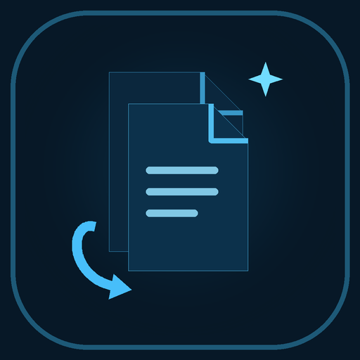

<p align="center">
  
</p>

<h1 align="center">ForgeBox</h1>

<p align="center">
  A local desktop toolkit for everyday file conversion.
</p>

<p align="center">
  <a href="https://github.com/kirtan-rasa/forgebox/releases">Releases</a>
  · <a href="CHANGELOG.md">Changelog</a>
  · <a href="LICENSE">MIT License</a>
</p>

<p align="center">
  <strong>Beta · Linux packages available</strong>
</p>

---

ForgeBox brings common image, PDF, document, spreadsheet, and media tools into one desktop app. It processes files on your computer and uses local command-line utilities for conversion tasks.

## Features

| Area | Tools |
|---|---|
| **Images** | Convert, resize, compress, grayscale, remove backgrounds, extract EXIF, OCR, generate QR codes, create PDFs from images |
| **PDF** | Merge, split, compress, rotate, reorder pages, render pages to images, add watermarks |
| **Documents** | DOC/DOCX → PDF and experimental PDF → DOCX conversion |
| **Data** | CSV ↔ JSON, CSV ↔ XLSX, JSON ↔ XLSX |
| **Audio & video** | Convert video, extract audio, and create GIFs with frame-rate and size controls |

### A few useful details

- Batch operations support multiple input files where the tool allows it.
- Images-to-PDF includes page previews and drag-to-reorder controls.
- Original files are never overwritten. ForgeBox chooses an unused output name.
- File dialogs and thumbnail generation run outside the UI thread.
- Conversion runs locally. ForgeBox does not upload selected files to a remote conversion service.

Background removal uses `rembg`; its model may be downloaded separately on first use.

## Download

Get the current packages from [GitHub Releases](https://github.com/kirtan-rasa/forgebox/releases).

| Linux distribution | Package | Install |
|---|---|---|
| Fedora and RPM-based systems | `.rpm` | `sudo dnf install ./forgebox-*.rpm` |
| Debian and Ubuntu | `.deb` | `sudo apt install ./forgebox_*.deb` |
| Arch Linux | `.pkg.tar.zst` | `sudo pacman -U ./forgebox-*.pkg.tar.zst` |
| Compatible x86_64 distributions | `.AppImage` | `chmod +x ./forgebox*.AppImage && ./forgebox*.AppImage` |

The AppImage contains the ForgeBox application and its packaged shared libraries, but not every conversion engine. Install the external utilities required by the tools you use. RPM, DEB, and Arch packages declare the dependencies available in their respective package repositories.

For package details and RPM signature verification, see [Linux packages](docs/LINUX-PACKAGES.md).

## Dependencies

ForgeBox uses external tools only for the features that need them.

| Utility | Used for |
|---|---|
| ImageMagick | Image conversion, resizing, compression, grayscale, image-to-PDF |
| Poppler | PDF merge, split, and page rendering |
| Ghostscript, qpdf, pdftk | PDF compression, page operations, and watermarking |
| LibreOffice | Office document and spreadsheet conversion |
| Tesseract OCR | Extracting text from images |
| ExifTool | Reading EXIF metadata |
| FFmpeg | Video conversion, audio extraction, and GIF creation |
| `rembg` | Background removal |

QR generation is built into ForgeBox and does not require a separate QR command-line tool. HEIC/HEIF support depends on the ImageMagick build and its format delegates. FFmpeg features depend on the codecs available in the installed FFmpeg build.

## Build from source

You need stable Rust and Cargo, plus the native development libraries used by `eframe` and `winit`.

On Fedora, install the project dependencies from the repository root:

```bash
bash scripts/install-deps-fedora.sh
```

Then build the release binary:

```bash
bash scripts/build.sh
```

The build script runs `cargo fmt` and `cargo build --release`. To run checks and tests before building:

```bash
FORGEBOX_RUN_CHECKS=1 bash scripts/build.sh
```

The resulting executable is `target/release/forgebox`. The release profile is configured to reduce link time on lower-powered CPUs.

## Wayland drag and drop

ForgeBox currently uses the `eframe 0.29` / `winit 0.30` stack. Its native Wayland backend does not provide the external file-drop events used by the app, so the repository includes a pinned compatibility patch for `winit 0.30.13`.

The patch receives local `text/uri-list` offers through `wl_data_device`, reads them asynchronously, and forwards the paths to the existing egui import flow. It refreshes MIME acceptance while a drag moves over the window for compositor compatibility, while negotiating copy-only actions once per drag.

Implementation notes and the pinned source revision are documented in [Wayland drag and drop](docs/WAYLAND-DRAG-AND-DROP.md). The current integration remains a compatibility patch until the eframe/egui-winit stack can adopt a suitable upstream winit API.

## Documentation

- [Linux packages and RPM signature verification](docs/LINUX-PACKAGES.md)
- [Fedora runtime dependencies](docs/FEDORA-RUNTIME-DEPENDENCIES.md)
- [Windows runtime dependencies](docs/WINDOWS-RUNTIME-DEPENDENCIES.md)
- [Wayland drag-and-drop implementation](docs/WAYLAND-DRAG-AND-DROP.md)
- [Changelog](CHANGELOG.md)

The current automated GitHub release workflow builds Linux packages. Windows packaging and runtime notes are present in the repository but are not yet part of that release workflow.

## Known limitations

- PDF → DOCX conversion depends on LibreOffice's PDF import and may alter complex layouts.
- Tall-image PDF export currently uses a fixed page-fragment height; paper size and page overlap are not configurable.
- OCR quality depends on the installed Tesseract language data.
- Background removal requires a separately configured `rembg` environment and model.
- External utilities retain their own format restrictions and security policies.

## License

ForgeBox is distributed under the [MIT License](LICENSE).
